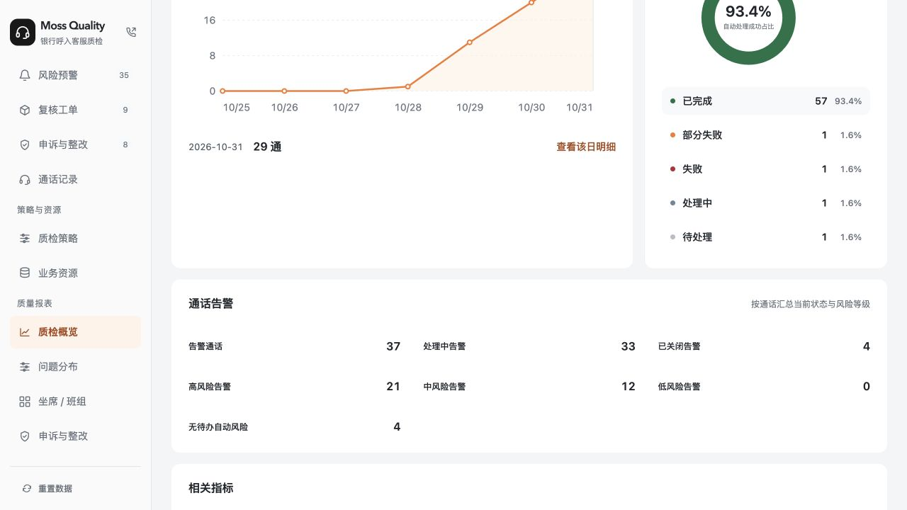

# 6003 系统与 PRD 差异复核

复核日期：2026-10-31。以下 D01–D14 为修复前的差异证据；本轮已在本地原型中修复并回归。当前进度以本节修复对照及《交付记录》为准。

## 本轮修复对照

| 差异 | 修复结果 | 验证 |
|---|---|---|
| D01 | 按通话与业务问题标识合并；每次命中独立保存规则、指标、批次、策略、证据；流程冲突由主管核查 | 新增回归用例 |
| D02 | 仅上调风险时收紧在办初审/处置时间，申诉核查期限保持 | 新增回归用例 |
| D03 | 风险分布限定未关闭告警 | 样例 21 高 + 12 中 = 3 待处理 + 30 处理中；4 通关闭另计 |
| D04 | 重检为每条命中写入新批次；最新批次规则和指标统计读取命中记录 | 同问题两规则重检仍一问题，保留四条命中 |
| D05 | 可选触发特征；失效引用拦截；按能力限制角色和条件；隐藏参数不校验；中段等待通话结束 | 自动测试；浏览器意图改名校验 |
| D06 | 保存触发时策略事实及原始依据；历史最高与关闭前等级分别记录 | 降级/延迟关闭回归；告警记录入口 |
| D07 | 已办结新证据由主管确认重开或维持，原结论与分发历史保留 | 权限/保留/重开/再次办结回归 |
| D08 | 配置保存检查真实接收人；运行时失效回默认并单独通知主管 | 回归覆盖仅通知坐席的策略 |
| D09 | 三种办理状态、关闭结果、阶段/责任/期限汇总、扩展筛选与人工补检确认 | 回归测试及页面检查 |
| D10 | 问题选择优先使用当前交互，外部深链接只负责初始定位 | 浏览器从 F-1039 切到 F-1039-B，证据与责任人同步 |
| D11 | 通话详情增加告警摘要；报表以告警编号下钻，支持查看问题与通话 | 浏览器往返检查 |
| D12 | 提醒间隔、指定质检组、流程首节点及退回/结束路径；重复提醒去重不吞新问题待办 | 通知快照/间隔/独立待办回归；配置界面 |
| D13 | 资源、策略、设置日志包含具体字段修改前后值，并可查看 | 日志回归和修改记录组件 |
| D14 | 接入通话全量自动检测；告警列表单独维护展示字段 | 旧检测范围配置失效回归及界面 |

截图批注与后续澄清：指标启停改为 Switch；指标规则页恢复“编辑规则”以维护业务触发条件，资源预览保持只读；业务资源页维护资源内容。

新增加 14 个针对缺陷的回归用例，合计 212 项通过。原有办理流程测试保留。生产集成待落实项仍按本文末尾记录；本轮交付本地原型。

## 核对依据与范围

- 需求：[飞书 6003 PRD](https://acnc6zeentra.feishu.cn/wiki/HkzuwVO6RifzR8kMiLRcdtsJnAd)，本轮经 CLI 回读，修订号 86，document_id `ZJP3dDgxpoV4PVxbkJfc8h5fnAf`。
- 实现：`projects/bank-voice-qc-6003` 当前工作目录；浏览器核验使用 `http://127.0.0.1:6003`。6001 仅作为此前指定的视觉基线。
- 范围：F01–F12，配置、检测、告警、复核、申诉、整改、角色与通知、报表和关联入口。
- 方法：PRD 逐模块对照、源码检查、原 198 项自动测试、10 个专项复现、浏览器核验。复现运行在独立内存数据中，未修改用户浏览器的业务记录。初次复核只记录问题；后续按用户“修复”指令更新了应用源码。
- 当前 GitHub / Vercel 项目已建立；当前代码仍处于本地验收阶段。生产接口和外部服务列于后文接入项。

## 已对齐的业务主线

| 模块 | 已实现内容 | 本轮证据 |
|---|---|---|
| 指标 / 资源 / 规则 | 12 类指标、12 个资源、12 条规则固定对应；指标开关；资源查看、编辑与直接保存；专业性含 SOP / 知识分区 | `scripts/6003.test.mjs`，配置源码与页面 |
| 策略关联 | 多条规则共用策略；单条规则仅关联一个策略；占用禁选；无策略使用默认配置；处理型指标不参与策略 | 配置测试、策略弹窗实看 |
| 配置生效 | 新检测捕获资源依据；资源更新保留原问题依据；在办流程继续；资源无发布、回滚或配置版本选择入口 | 资源更新测试、`captureRules` / `captureBasis` |
| 告警聚合 | 同通话创建一条告警；不同问题独立办理；部分办结保持告警开放；新问题重开沿用编号 | 聚合专项测试；跨规则问题合并仍有 D01 |
| 默认流程 | 初审、按需复核、主管确认、坐席接受或申诉，继续整改 | 现有流程与动作契约测试 |
| 申诉 / 整改 | 补件、退回核查、裁定、核验、退回整改、补派人员、材料和轮次等主路径保留 | 现有回归测试；策略改级对核查期限存在 D02 |
| 证据 / 通用交互 | 原音、转写定位、问题证据、资源依据、弹窗与角色动作控制 | 既有测试及本轮关联事项浏览器检查 |
| 报表 | 四子模块、筛选、明细和导出保留；增加通话告警统计 | 报表源码与浏览器；新增口径有 D03、D11 |

## 优先修复的逻辑错误

### D01 · 同一业务问题跨规则命中会重复建问题

**优先级：高。PRD：4.2、6.3、A03 / A11。**

要求：问题按业务问题标识关联，一个问题可有多条规则、指标、策略及证据。重复命中追加记录，独立问题才分别创建。

实际：去重键为 `ruleId:problemKey`；同通话、相同 problemKey 分别命中隐私性和禁用词后，实际产生 2 个 Finding、1 个 CallAlert。每个 Finding 只有一个主 ruleId / basis，重复问题可以分别进入任务，放大问题数和办理量。

位置：[lib/call-alerts.ts:59](../../lib/call-alerts.ts#L59)，[lib/workflow.ts:112](../../lib/workflow.ts#L112)。

修正：以通话和业务问题标识定位唯一 Finding；独立保存多条命中记录及对应规则、策略、批次和证据。不同规则的流程要求冲突时沿用当前流程并交主管核查。

### D02 · 策略等级变化误改申诉核查期限

**优先级：高。PRD：4.2.1、A03 / A06。**

要求：等级上调只收紧尚未完成的初审 / 主管处置期限；降级不自动延期；申诉、补件和整改按各自约定期限办理。

实际：`reconcileAlerts` 遍历所有关联 Review，包含申诉核查。把高风险策略调为低风险时，样本 `WO-AP-UI-7` 原截止北京时间 11 月 2 日 16:00，被改成 10 月 31 日 11:05:47；复现时点为 10 月 31 日 16:00，直接产生过去的截止。

位置：[lib/call-alerts.ts:19](../../lib/call-alerts.ts#L19)。

修正：只处理需要随风险升高收紧、且仍在初审 / 主管处置阶段的时钟；按任务类型和阶段隔离申诉核查等后续期限。

### D03 · 风险分布把已关闭告警也计入

**优先级：高。PRD：5.5 指标 10、A11。**

要求：高 / 中 / 低 / 无可聚合等级的合计等于未关闭告警数。

实际：默认样本报表未关闭 33、已关闭 4；分类为高 21、中 12、低 0、无待办自动风险 4，合计 37。风险分类只过滤 level，未过滤告警状态；4 条关闭记录被计入无风险分类。浏览器与专项脚本结果一致。

位置：[lib/reports.ts:93](../../lib/reports.ts#L93)。

修正：风险分布统一从未关闭告警集合计算，关闭结果单独统计；补充包含关闭样本的对账用例。

### D04 · 重检命中记录未关联最新批次

**优先级：高。PRD：3.3.2、5.1、6.3、A02 / A03。**

要求：重检生成独立批次，保留每次结果和依据；同问题保持唯一，并能查到最新批次的有效命中。

实际：重检重复命中只追加证据，没有保存本次批次命中。Finding 的 batchId 仍为旧批次；`callTriggers` 按最新 batchId 查 Finding，返回命中规则 0、命中指标 0。同一口径也用于“未命中规则”列表筛选，实际已有重复命中的通话会被归入未命中。

位置：[lib/call-alerts.ts:60](../../lib/call-alerts.ts#L60)，[lib/call-triggers.ts:6](../../lib/call-triggers.ts#L6)，[components/workspace.tsx:223](../../components/workspace.tsx#L223)。

修正：检测结果按批次独立追加，再关联唯一问题；最新批次统计读取检测记录，历史问题保留原始来源。

### D05 · 检测条件选择、有效性校验与执行范围未闭合

**优先级：高。PRD：3.4–3.5、A09 / A10。**

1. 资源编辑只能修改预置 condition 的角色、阶段、次数或时长，缺少“选哪些情绪、意图、声纹异常或表达特征参与触发”的配置。情绪条件含平静，用户无法只选择愤怒而排除平静。
2. 意图内容改名后，旧条件仍引用原名称，保存成功。专项复现将“查询转账进度”改为“新的业务意图”，条件仍保留“查询转账进度”。
3. 多数指标共用全部角色、全部阶段及持续时长选项，缺少按指标能力限制。隐藏字段仍参与校验：累计次数填 0 后切回单次命中，仍被隐藏的次数错误阻止保存。
4. “服务中”依赖结束前偏移，PRD 要求在结束后判断。当前通话未结束也能命中；专项复现得到 1 个问题，预期应等待结束确认范围。

位置：[components/rule-resource-dialog.tsx:49](../../components/rule-resource-dialog.tsx#L49)，[lib/configuration.ts:9](../../lib/configuration.ts#L9)，[lib/call-alerts.ts:55](../../lib/call-alerts.ts#L55)。

修正：明确各指标可用能力，条件特征从有效资源内容选择，保存时检查引用；只验证与执行当前生效字段；依赖终点的判断等待通话结束。

### D06 · 历史命中等级和策略事实保存不完整

**优先级：高。PRD：3.3.2、3.6、4.2、5.2。**

要求：每次命中保留当时等级、策略 / 默认设置、提醒角色及流程；告警保存历史最高等级、关闭前等级、变化原因和关联对象。

实际：资源依据快照已保存；问题 workflow 只记录 flowId、policyName、reason，未记录策略 ID、命中等级及提醒角色。策略改级直接覆盖 Finding.severity。CallAlert 缺少历史最高等级、关闭前等级；history 只记录聚合状态、等级和通用原因，无法还原各命中当时配置。关闭后显示“无待办风险”。

位置：[lib/workflow.ts:114](../../lib/workflow.ts#L114)，[lib/workflow.ts:284](../../lib/workflow.ts#L284)，[lib/call-alerts.ts:18](../../lib/call-alerts.ts#L18)、[67](../../lib/call-alerts.ts#L67)。

修正：保存不可变的命中事实和独立的当前聚合结果；增加告警历史最高 / 关闭前等级与关联事件。该记录属于业务追溯，配置仍直接更新。

### D07 · 已办结问题的新证据缺少主管确认路径

**优先级：高。PRD：4.2“关闭后新增”、A03。**

要求：已办结问题收到新证据时，主管确认是否重开；保留正式结论。

实际：重复业务问题的新证据直接并入 finding.evidence，告警继续关闭；无新增通知、待确认事项或重开确认动作。复现中证据从 `[0]` 变成 `[0,1]`，最后业务日志仍是“确认误报并归档”。

位置：[lib/call-alerts.ts:60](../../lib/call-alerts.ts#L60)。

修正：追加命中记录，产生主管待确认事项；确认后重开原问题 / 原告警，原结论和关闭记录保留。

### D08 · 特殊流程失效时未保证通知主管

**优先级：高。PRD：3.6“边界与兜底”、A09。**

要求：特殊流程失效或无接收人，转默认流程、记原因并通知主管。

实际：流程和原因正确回退，但通知仍沿用原策略 recipients。策略只提醒坐席时，失效兜底后收件人只有 `A1048`，主管收不到此次兜底通知。此外，策略保存只校验流程 enabled，未校验其接收人有效。

位置：[lib/configuration.ts:44](../../lib/configuration.ts#L44)，[lib/call-alerts.ts:64](../../lib/call-alerts.ts#L64)、[74](../../lib/call-alerts.ts#L74)。

修正：保存阶段校验流程可执行；运行阶段兜底时额外通知责任主管，和普通提醒分开记录。

## 页面与配置缺项

### D09 · 告警状态、关闭结果和汇总字段缺失

**优先级：中。PRD：4.2、5.5、6.2。**

- PRD 为待处理 / 处理中 / 已关闭 / 全部告警；实现只有 open / closed，首次未处理的告警直接落在“处理中”。
- 未保存“全部排除 / 处理完成”关闭结果，也没有对应筛选与分别统计。
- 聚合详情缺各阶段问题数、责任汇总、最早未完成截止和逾期问题数；当前只显示已办结 / 总数及选中问题的责任。
- 缺问题阶段多选、指标、班组、关闭时间与关闭结果等要求的筛选。
- 关闭依赖最新批次全部 success，尚无“人工补检经主管确认应检范围完成”的替代路径。

位置：[lib/workflow.ts:287](../../lib/workflow.ts#L287)，[lib/call-alerts.ts:33](../../lib/call-alerts.ts#L33)，[components/call-alerts.tsx:26](../../components/call-alerts.tsx#L26)。

修正：先补聚合状态和关闭结果模型，再统一列表、详情、通知、筛选、导出与报表。

### D10 · 从问题深链接进入时，多问题选择器切换失效

**优先级：中。PRD：4.2、6.2、A13。**

浏览器复现：打开 `?view=alerts&id=F-1039`，选择“未完整说明处理时限”；页面仍停在“出现消极服务表达”。URL 中的 focusedFinding 始终优先于本地 problemId。普通告警编号入口此前检查通过，此路径漏测。

位置：[components/call-alerts.tsx:22](../../components/call-alerts.tsx#L22)。

修正：URL 对象用于首次定位；用户切换问题后更新选中对象或同步 URL，保证通知入口和列表入口行为一致。

### D11 · 通话详情与报表下钻未接到聚合告警

**优先级：中。PRD：5.1、5.5、6.2。**

通话详情仍只列问题和复核 / 申诉 / 整改等事项，缺唯一 CallAlert 的入口、当前风险与汇总进度。告警报表明细使用 Call.id，点击打开通话详情；无法直接查到告警聚合历史，导出也缺告警编号等关联字段。

位置：[components/workspace.tsx:544](../../components/workspace.tsx#L544)，[lib/reports.ts:88](../../lib/reports.ts#L88)。

修正：通话详情增加告警摘要与原告警入口；告警明细以 CallAlert.id 为对象编号，保留 callId，并下钻对应告警 / 问题。

### D12 · 策略提醒与特殊流程信息不足

**优先级：中。PRD：3.6、4.2。**

- 缺重复提醒间隔：每通话一次、1 分钟、5 分钟、自定义秒数；实现仅对新建 Finding 发送一次日志 / reminder，无按通话＋策略＋接收对象的间隔控制。
- 接收方只有角色复选，没有“指定质检组”选择；运行时按角色遍历全部演示人员，未表达所属主管 / 组范围。
- 特殊流程目前只有“优先质检员检查”预置项，首节点固定给 Q01。配置页没有展示首节点责任、退回路径和结束路径。完整特殊流程清单属于 PRD 待落实事项，应结合业务清单补齐。

位置：[components/strategy.tsx:64](../../components/strategy.tsx#L64)，[lib/workflow.ts:284](../../lib/workflow.ts#L284)，[lib/call-alerts.ts:73](../../lib/call-alerts.ts#L73)。

修正：补提醒间隔及组织接收范围；将提醒投递和流程待办分开；现有流程选择旁展示完整责任与路径摘要。

### D13 · 配置变更记录缺具体差异

**优先级：中。PRD：3.7。**

配置日志保存动作、人员、时间和 note；资源修改说明可为空，策略统一写“保存预警策略”。没有结构化记录变更字段与前后值，无法回答“谁把哪个条件从什么改成了什么”。

位置：[lib/configuration.ts:55](../../lib/configuration.ts#L55)，[components/strategy.tsx:61](../../components/strategy.tsx#L61)。

修正：保存配置时生成字段差异记录，资源明细记录修改摘要及必要前后内容，仍使用直接保存流程。

### D14 · 全量自动检测与列表展示

**当前口径（2026-11-01）：所有接入通话自动、全量进入检测。**

移除检测业务范围、允许耗时及超时提醒配置。旧范围配置不再参与通话检测，列表展示设置只控制告警队列字段。指标开关与规则适用业务继续控制具体检查项。

验收：旧配置限制某个业务时，该业务通话仍可匹配已开启的适用规则；展示字段保存不影响检测；策略工具栏无检测设置入口。

## 生产接入与交付项

这些事项按 PRD 接入计划推进，与上述可在本地原型中修复的行为缺陷分开追踪：

| 项目 | 当前情况 | 6003 要求 |
|---|---|---|
| 身份与权限 | 演示角色切换、客户端对象权限 | 服务端身份、组织与对象范围，对查询、办理、导出和材料统一鉴权 |
| 存储与事务 | 浏览器 localStorage、客户端状态令牌 / 幂等校验 | 服务端持久化、事务、并发首次命中唯一约束、状态冲突恢复 |
| 检测服务 | 预置事实、检测回调适配函数和演示检测完成 | 真实音频 / 模型接入；每项执行状态、命中 / 未命中 / 无法判断 / 不适用与实际证据 |
| 音频、材料、消息 | 本地录音样例、演示材料及通知日志 | 授权音频与附件接口、上传下载失败处理、投递回执 / 重试、值班兜底 |
| 上线资料 | 本地可运行，仓库和部署项目已建 | 代码发布、部署验证、容量、监控、备份恢复、正式验收记录 |
| 文档对应页面 | PRD 仍有截图占位，原资产入口尚待当前项目交付同步 | 最终页面确认后更新截图、页面入口、代码 / 部署地址和验收状态 |

## 本轮验证记录

1. `pnpm test:workflow`：198 / 198 通过。现有测试覆盖既有主流程及 9 个 6003 专项场景；本轮 10 个复现揭示当前用例缺少跨规则同问题、带关闭记录的风险分布、策略与申诉期限联动等场景。
2. [专项复现脚本](audit/reproduce.mjs)：10 个场景，输出 [复现结果](audit/reproduce-results.json)。不调用网络，不写业务存储；按预置时点在内存运行。
3. 临时副本中将“所有检查成功才允许关闭”反转，6003 专项测试由 9 / 9 通过变为 8 / 9，通过失败用例确认关闭门槛有回归保护。源码副本已恢复，运行项目未改动。见 [检查记录](audit/mutation-check.txt)。
4. 浏览器实际核验：预警三个页签、关闭结果显示、37 / 33 / 4 报表数字、告警明细下钻、通话问题与事项、问题深链接切换失败、策略配置字段。过程中未保存配置或提交办理动作。
5. 本轮无应用代码变更，沿用上一轮已通过的类型检查、Lint 与生产构建；本轮重新执行业务测试和差异复现。

## 修正顺序

1. 先统一问题与命中数据模型，修复 D01 / D04 / D06 / D07；保留一通一告警和一个业务问题多个命中。
2. 修复 D02 期限串改、D03 统计口径和 D08 兜底通知，增加针对性回归。
3. 补齐 D05 检测配置及 D09–D14 页面、入口、提醒和变更记录。
4. 按 A01–A14 补充此次缺失场景，再做三角色浏览器验收，最后同步交付文档和部署。
