# 6003｜质检策略与业务资源逻辑梳理

整理日期：2026-11-02（北京时间）。依据为 localhost:6003 当前页面与本项目源码；本文描述当前实现。需求差异另见[PRD 对照](./质检策略与业务资源PRD对照-20261102.md)。

## 1. 两个页面的业务分工

| 对象 | 回答的问题 | 维护入口 | 当前可操作内容 |
|---|---|---|---|
| 指标 | 要检查什么、是否执行 | 质检策略 → 指标规则 | 开启、关闭；定义由系统提供 |
| 业务资源 | 用什么业务内容作为依据 | 业务资源 | 查看、编辑内容明细，部分类型支持 CSV |
| 指标规则 | 什么情况算命中 | 质检策略 → 指标规则 → 编辑规则 | 特征、检测对象、阶段、次数、时长、语速阈值 |
| 预警策略 | 命中后按什么等级、通知谁、走什么流程 | 质检策略 → 预警策略 | 新增、编辑、删除；关联规则、等级、接收人、重复提醒、流程 |
| 默认预警设置 | 没有关联策略时怎样处理 | 系统提供 | 当前默认为中风险、主管接收、主管优先处理 |

固定关系为 **12 个指标 ↔ 12 个资源 ↔ 12 条规则**。一份资源可有多条内容明细。一个策略可关联多条规则，一条可预警规则最多关联一个策略。语音识别、文本纠错属于处理型规则，输出文本结果；另外 10 条规则可产生预警。

```mermaid
flowchart TD
  A[业务资源：词条、规范、SOP、知识、注册资料] --> C[固定指标规则]
  B[规则配置：特征、对象、阶段、门槛] --> C
  D[指标开启及适用业务] --> C
  C --> E[启动检测，保存当时资源与条件]
  E --> F{规则结果}
  F -->|处理型| G[转写或纠错结果]
  F -->|未命中| H[检测记录]
  F -->|风险命中| I[读取策略或默认设置]
  I --> J[预警消息：接收人及重复间隔]
  I --> K[问题待办：默认或特殊流程]
  K --> L[同一通话聚合一条告警，问题分别办理]
```

推荐配置顺序：维护资源内容 → 配置指标规则 → 配置策略关联 → 开启指标 → 后续检测使用新配置。当前样例默认已开启全部 12 项。

## 2. 质检策略：指标规则

入口：`/?view=rules`。页面有“指标规则”“预警策略”两个页签，左侧选择记录、右侧查看详情。没有选中 ID 时展示筛选结果第一项；空结果展示空状态。

### 列表及详情

| 项目 | 当前行为 |
|---|---|
| 搜索 | 按规则名或指标名检索，去首尾空格，忽略大小写 |
| 指标状态 | 全部状态、已开启、已关闭 |
| 策略关联 | 全部关联状态、已关联策略、未关联策略、无需策略 |
| 顺序 | 10 条可预警规则在前，2 条处理型规则在后；组内保持原顺序 |
| 计数 | 显示当前筛选结果中的“已开启数 / 总数” |
| 列表卡片 | 规则名称、指标、关联资源、策略名称、指标开关 |
| 重置 | 清空搜索和筛选，清除当前选中 ID |
| 详情 | 检测条件、资源名称与查看入口、关联策略及其等级／通知／流程 |
| 编辑规则 | 主管可编辑 10 条风险规则；2 条处理型规则只展示处理说明 |
| 查看资源 | 打开只读资源弹窗；维护内容需进入业务资源页 |
| 查看策略 | 打开只读策略弹窗；维护关联需进入预警策略页 |

指标开关直接保存，不需发布。关闭后，新启动的检测排除该指标；已启动批次保留原规则和依据，既有问题、告警及任务继续办理。重新开启时校验资源及规则；专业性同时校验 SOP 和业务知识。处理型规则无风险条件必选要求。

### 条件配置

同一规则可选多个特征，每个已选特征分别配置门槛，满足任一有效条件即可触发。每个特征只能出现一次，风险规则至少保留一个已选特征。

| 字段 | 选项／数值范围 | 显示与执行规则 |
|---|---|---|
| 检测特征 | 按资源类型提供，详见第 4 节 | 未选特征的参数保留，跳过执行和有效参数校验 |
| 检测对象 | 坐席、客户、双方 | 声纹、服务礼仪仅允许坐席；其余风险规则提供三项 |
| 检测阶段 | 全程、开场、服务中、结束 | 当前全部风险类型均开放四项 |
| 阶段范围 | 1–3600 秒，整数 | 开场从起点算；结束从通话终点倒数 |
| 服务中偏移 | 开始后 0–3600 秒、结束前 0–3600 秒 | 结束后判断；有效中段长度须大于 0 |
| 触发方式 | 单次命中、累计次数、持续时长 | 情绪、静默、语速提供持续时长；抢话与其他类型提供单次／累计 |
| 累计次数 | 1–1000，整数 | 仅累计模式显示 |
| 统计窗口 | 0–3600 秒，整数 | 0 为整通通话；正数为最近指定秒数；当前用数值输入框 |
| 持续时长 | 1–3600 秒，整数 | 仅持续模式显示；接收检测服务报告的持续数值 |
| 语速阈值 | 30–600 字／分钟，整数 | 过快使用大于阈值，过慢使用小于阈值 |
| 修改说明 | 选填 | 与保存记录一起留存 |

声纹规则使用紧凑条件表，其余使用通用条件表单。累计次数、窗口和持续数据由检测事件传入，原型执行门槛检查；实际音频识别与事件计数由检测接入负责。

保存成功关闭弹窗并同步详情。无变更时禁用保存；错误保留输入。编辑时记住规则修订号，旧修订提交被拒绝。点击“取消”直接放弃；关闭图标／Esc 在有修改时询问是否放弃。

## 3. 质检策略：预警策略

### 列表与表单

列表按名称搜索，按高／中／低等级筛选；展示规则数、接收人和流程。详情可查看关联规则并切换对应指标开关，该开关与指标规则页共用同一状态。

| 字段 | 默认值／可选项 | 保存校验 |
|---|---|---|
| 策略名称 | 新建为空 | 1–100 字，去首尾空格后不得与其他策略同名 |
| 适用规则 | 新建未选 | 至少一条；仅 10 条风险规则；已被其他策略占用的规则显示占用信息并禁选 |
| 预警等级 | 新建为中风险 | 高、中、低 |
| 通知接收人 | 新建为所属主管 | 所属主管、质检员、当前坐席；至少一项，不重复 |
| 重复提醒 | 新建为每通话一次 | 每通话一次、1 分钟、5 分钟、自定义 1–86400 整数秒 |
| 处理流程 | 新建为优先质检主管 | 从启用且有可用责任人的流程中选择 |

当前页面无“提醒方式”字段，保存时统一写入 `notification`。选择“质检员”时发送给当前原型人员目录中的质检员；选择“当前坐席”时发送给通话所属坐席。

当前有两个流程：

| 流程 | 首节点 | 后续规则 |
|---|---|---|
| 优先质检主管 | 主管处理 | 按问题确认误报、转检查或正式分发 |
| 优先质检员检查 | 系统自动分流给质检员 | 按未办结复核工单最少优先，同数按人员标识稳定选择；检查后交主管 |

流程说明提供首节点、退回与结束路径。通知接收人控制消息；流程决定任务责任人。即使只选择通知坐席，主管／质检员仍按流程获得办理任务。

### 关联、删除与生效

1. 一条策略内多选规则，只共用预警后配置；各规则独立判断。没有跨规则 AND／OR、累计若干规则才触发或自动复合升级。
2. 规则换策略时，先在原策略解除，再在新策略关联。已关闭的指标仍可预先关联策略。
3. 当前策略至少需保留一条规则。需要解除最后一条时，通过删除策略释放关联。
4. 删除策略需二次确认；关联规则随后使用默认设置，检测继续执行。
5. 首次命中立即发送消息。相同通话＋策略＋接收人按间隔去重；每个新问题的待办单独创建。
6. 已有问题重复命中追加证据，继续原流程，提醒沿用该问题首次命中的配置。新增命中携带不同流程要求时提示主管核查。
7. 配置保存后重算未办结自动问题及告警等级。当前实现按规则的**现关联策略**查等级，关联变化也会改动旧问题等级；与飞书现版的差异见对照 D02。
8. 等级上升收紧尚未完成的初审／处置期限；等级下降保留期限。申诉、补件、整改使用各自期限。

当前样例共 3 条策略：合规安全预警（高，4 条）、服务质量预警（中，4 条）、服务规范预警（低，2 条）。这是演示配置，策略数量可变。

## 4. 业务资源：固定对象与内容字段

入口：`/?view=resources`，12 个资源与指标规则同序展示，列表无分页。字段为业务资源、记录、对应指标、对应规则、更新时间、操作。支持资源／规则名称及资源编号检索，指标名通过规则名覆盖；当前搜索区分字母大小写。

点击名称、查看按钮或行内空白打开详情；选中文字和独立操作不触发行点击。主管可由列表“编辑”或详情“编辑内容”进入表单。质检员只读。坐席没有这两个配置模块入口。

以下 `*` 为保存必填字段；规则名称统一为“指标名称＋规则”。

| 指标 → 资源 | 内容字段 | 内容操作 | 规则可选特征 |
|---|---|---|---|
| 声纹识别 → 声纹库 | 坐席／工号*、注册语音*、启用状态* | 注册资料表；增删行；启用／停用的是注册明细 | 身份不匹配、未注册声纹、无法确认身份 |
| 关键词检出 → 关键词库 | 关键词*、同义词 | 表格、CSV；同义词用中文分号分隔 | 指标命中 |
| 情绪识别 → 情绪标签 | 情绪名称*、情绪描述* | 固定四条；名称限愤怒／焦虑／悲伤／平静；无增删及 CSV | 从当前资源名称读取 |
| 意图识别 → 意图定义 | 意图名称*、定义*、正例、反例 | 表格、CSV、增删行 | 从当前资源名称读取 |
| 服务礼仪 → 服务礼仪规范 | 检查项名称*、必说要素*、允许表达、例外表达 | 表格、CSV；必说要素用中文分号分隔 | 规范缺失 |
| 语言表达 → 语言表达参数 | 表达特征*、说明* | 表格、CSV、增删行 | 代码固定提供静默、抢话、语速过快、语速过慢 |
| 专业性 → 专业性业务依据 | SOP：名称*、序号*、内容*、是否必需*；知识：主题*、内容*、依据名称 | 同弹窗上下两个区；SOP 横向步骤矩阵；两区独立导入／下载，一次保存 | 指标命中 |
| 隐私性 → 隐私规则 | 规则名称*、信息类型*、禁止行为*、正例、反例、脱敏要求 | 表格、CSV；脱敏枚举：全部遮蔽／仅显示后四位／不脱敏 | 指标命中 |
| 禁用词 → 禁用词库 | 禁用词*、类别、例外 | 表格、CSV、增删行 | 指标命中 |
| 消极情感 → 服务态度规范 | 表现名称*、判定说明*、正例、反例、例外 | 表格、CSV、增删行 | 指标命中 |
| 语音识别 → 识别热词 | 词条* | 表格、CSV、多行粘贴拆为多条 | 处理型，无预警条件 |
| 文本纠错 → 纠错词库 | 易错文本*、正确文本* | 表格、CSV、增删行 | 处理型，无预警条件 |

资源对象固定，内容明细按类型维护。声纹明细的启用状态与指标总开关分开：前者属于注册资料，后者决定是否启动该指标检测。

专业性列表的“记录”统计 **SOP 步骤数＋知识条数**。当前样例是 2 个 SOP、6 个步骤、5 条知识，列表显示 11 条；弹窗分别展示 SOP 数、步骤数和知识数。

声纹“选择音频文件”当前只保存文件名，音频上传、存储与真实注册比对待接入。当前资源存储为结构化 CSV 文本，配置保存在浏览器本地存储。

### 编辑、导入和校验

1. 进入编辑时复制当前内容和修订号；查看内搜索仅改变匹配展示。
2. 支持 CSV 的类型可下载当前草稿、上传替换、撤销最近一次替换。专业性两个分区分别操作。
3. 文件须为 `.csv`、UTF-8（允许 BOM），最大 5 MB、正文最多 10 万字；支持引号内逗号和换行。
4. 整文件校验通过才替换草稿；显示文件名、条数和尚未保存。空文件、仅表头、错误表头、列数或内容失败均保留原草稿。
5. 资源按首字段检查重复；SOP 使用名称＋步骤序号，组内序号从 1 连续递增；是否必需只允许是／否。纠错原词不得重复配置，意图名称唯一。
6. 保存再次校验全部内容及规则引用。专业性两个分区都需至少一条有效数据，统一保存成功。
7. 保存失败保留输入；取消直接放弃；关闭图标／Esc 遇未保存内容时确认放弃。修订号变化时阻止提交。
8. 保存成功用于后续新启动的检测；原批次、命中和依据快照保持原内容。

### 跨页依赖：意图改名

已被有效规则选中的意图名称改名或删除，会被资源保存校验拦截。当前可行顺序：先在资源中新增新意图并保留旧意图 → 在指标规则中选新意图、取消旧意图 → 返回资源删除旧意图。单纯改描述、正例、反例可直接保存。

语言表达当前存在另一种行为：资源内增删／改名特征后，规则的四项固定特征列表仍保持原样，详见对照 D03。

## 5. 保存与执行的时间边界

| 变更 | 后续新检测／新问题 | 已开始检测与在办问题 |
|---|---|---|
| 资源内容 | 新批次采用新内容 | 批次与命中保留原依据 |
| 检测条件 | 新批次采用新条件 | 已启动批次继续原条件 |
| 指标关闭 | 新批次排除该指标 | 已启动批次可回调；原问题和任务继续 |
| 策略提醒／流程 | 新问题采用新配置 | 继续首次命中的提醒和既有流程 |
| 策略等级 | 新问题采用当前等级 | 当前实现即时重算有效未办结问题 |
| 策略关联／删除 | 新问题使用新策略或默认设置 | 当前实现也改变旧问题当前等级，PRD 对照列为差异 |

配置命令检查主管身份、目标修订号及重复请求，成功后记录修改人、时间和具体字段前后值。数据层为浏览器 `localStorage`，服务端组织鉴权、事务、真实检测、附件与消息投递仍是接入工作。

## 6. 实现定位

| 内容 | 源码 |
|---|---|
| 指标／策略两页签及策略表单 | `components/strategy.tsx` |
| 规则条件编辑 | `components/indicator-rule-dialog.tsx`、`detection-conditions-editor.tsx`、`voice-conditions-editor.tsx` |
| 资源列表、查看与编辑 | `components/resource-catalog.tsx`、`rule-resource-dialog.tsx`、`structured-resource.tsx` |
| CSV 操作与内容校验 | `components/resource-file-import.tsx`、`lib/resource-import.ts` |
| 字段定义与能力约束 | `lib/strategy-schema.ts`、`lib/configuration-schema.ts` |
| 保存命令与依据快照 | `lib/configuration.ts` |
| 命中、通知、告警聚合 | `lib/call-alerts.ts` |
| 特殊流程自动分流 | `lib/flow-routing.ts` |
| 本地持久化 | `lib/store.ts` |
